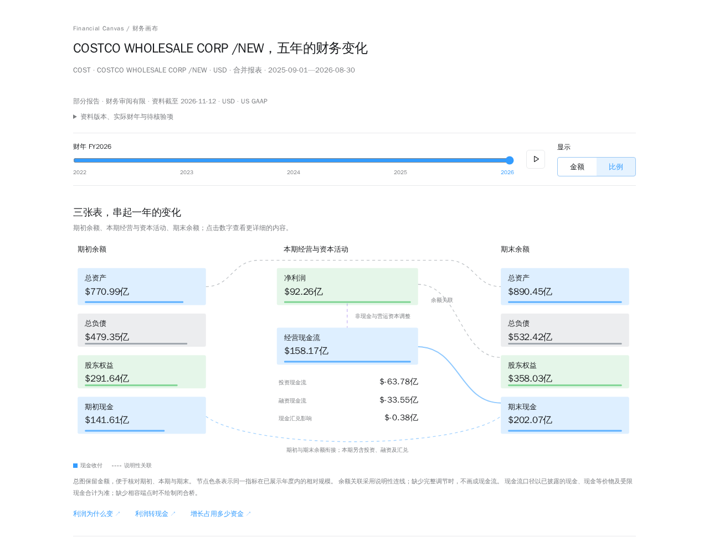
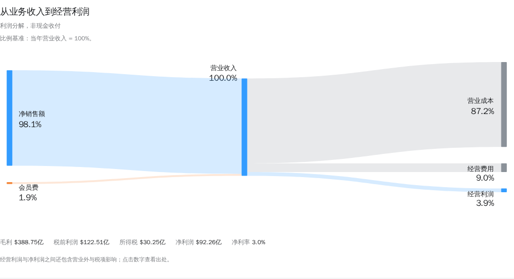

# Financial Canvas · 财务画布

[中文](README.md) · [English](README.en.md)

Turn a US stock ticker, SEC data, and source-backed research into **one standalone, interactive HTML financial report per company**. The report interface is currently in Chinese.

This is an experimental project licensed under MIT. The program handles data retrieval, caching, fiscal periods, fact validation, decimal arithmetic, and packaging. The repository's Skill guides your current AI environment through research into official filings. No FutuMCP connection or separate model API configuration is required.

## Explore a report

Try the [PDD online report](https://value.wonderjz.workers.dev/reports/financial-visualizer?symbol=PDD), or download a generated single-company HTML:

| Offline report | Complete fiscal years | Data cutoff |
| --- | --- | --- |
| [Costco · COST](examples/reports/COST.html) | FY2022–FY2026 | 2026-11-12 |
| [Apple · AAPL](examples/reports/AAPL.html) | FY2022–FY2026 | 2026-11-12 |
| [Adobe · ADBE](examples/reports/ADBE.html) | FY2021–FY2025 | 2026-11-12 |

Download an HTML file, or clone this repository and open it in a browser. GitHub's file page displays the source code. All three examples use USD and embed one company's data, styles, and scripts for fully offline reading. They retain source links and explicit data gaps; they do not represent complete financial audits. The PDD link opens an existing WonderValue historical page that uses a different data supplementation workflow. That page and its legacy data are not bundled here. See the [example notes and provenance](examples/README.md) for details.

Actual screenshots of the COST report: switch fiscal years and amount/percentage modes, then click a metric to inspect its sources.



<details>
<summary>See the revenue-to-operating-income breakdown</summary>



</details>

## Get started

Report generation requires Python 3.10+ and uses only its standard library. The first data retrieval needs internet access. Reading a generated HTML requires only a browser, with no server, Python installation, or network connection.

```bash
git clone https://github.com/wonderjz99/financial-canvas.git
cd financial-canvas
```

Open the project in an AI environment that can read local files and run Python, then ask:

> Read `skills/financial-statement-visuals/SKILL.md` and use Financial Canvas to generate a COST report for the latest five disclosed complete fiscal years. Research the listed gaps using official evidence, retain sources and unresolved gaps, and deliver a standalone HTML file.

See the [Skill usage guide](docs/skill-usage.md) for details. The Skill does not start a separate model service, and copying the Skill alone does not install this project. Supporting documentation and the report interface are currently in Chinese.

## Command workflow

Prepare a fresh workspace:

```bash
python3 scripts/report.py prepare --symbol COST --workspace .local/v2/workspaces/COST-demo
```

`prepare` returns normalized facts, official source files, checks, and research tasks. Supply a project name and contact email using `--user-agent "Project name contact@example.com"` or `SEC_USER_AGENT` for SEC requests. Choose a new workspace name if the directory already exists.

Read `research-tasks.json`, `normalized.json`, and `checks.json`, then write source-backed observations to `supplements.json` using official HTML filings or other verified primary material. Do not edit raw sources or `normalized.json`, and do not invent amounts to make a relationship balance.

Build offline:

```bash
python3 scripts/report.py build --workspace .local/v2/workspaces/COST-demo
```

The default output is `reports/COST.html`. If it already exists, choose another `--output` or explicitly use `--overwrite`. An empty supplement file is allowed: the result is a partial report supported by available facts, rather than completed financial research.

Use `prepare --refresh` to fetch new versions; valid cached versions are reused by default. A failed refresh can retain a previously verified cache version, which is identified in the output. `prepare --offline` uses only valid existing cache entries. `build` neither accesses the network nor calls AI or fills missing facts. See the [workflow and evidence contract](docs/report-v2.md).

## Scope

- US-listed, non-financial companies reporting under US GAAP; up to five disclosed complete fiscal years, using actual dates and reporting currencies, including 52/53-week years.
- Fiscal-year controls, playback, amount/percentage modes, source drilldowns, three-statement views, and evidence-supported analysis. Business segments, complete CFO reconciliations, and cross-year comparability require official evidence.
- Financial/real-estate SIC codes 6000–6999, IFRS, quarterly reports, valuation, and trading are outside the current scope. Unconfirmed identity, currency, or fiscal periods stop the workflow.
- Unknown values stay unknown. Incomplete reconciliations do not become artificial balanced bridges. Structural and arithmetic checks are not independent financial audits.

The repository includes fixed-date COST, AAPL, and ADBE examples with item-level sources, but no raw filings, research workspaces, or caches. Automated tests use synthetic inputs and do not prove coverage of real companies.

## Verification

Default verification uses the code and synthetic fixtures:

```bash
python3 -B scripts/verify.py
```

It does not read V1 snapshots or contact financial services. Browser development checks require Node.js 22+:

```bash
npm ci --ignore-scripts
npx playwright install chromium
python3 -B scripts/verify.py --browser
```

CI covers Linux with Python 3.10/3.12, Windows with Python 3.12, and Chromium at three viewport sizes. Publication checks inspect the Git index and fetched history, reject legacy data and unreviewed reports, and verify each included example's hash, single-company identity, and official sources. See the [development guide](docs/development.md).

## Repository and license

- `scripts/report.py`: command entry point; `financial_visualizer/`: validation, fixed calculations, and export.
- `skills/`: AI research instructions; `web/`: offline components; `tests/`: synthetic inputs and interaction tests.
- `examples/`: three reviewed reports and their version manifest; `docs/images/`: actual report screenshots.
- `.local/v2/` and `reports/`: local data and generated outputs, ignored by Git and absent from a fresh clone.

Project-owned code, documentation, and synthetic tests use the [MIT license](LICENSE). It does not grant rights to third-party source materials, development dependencies, external services, or trademarks. See the [third-party notices](THIRD_PARTY_NOTICES.md) and [data-source notes](docs/data-sources.md).

This is an independent source distribution with no inherited research-repository history, legacy vendor snapshots, V1 HTML, prototypes, or internal handoff notes. Internal `v2` protocol and directory identifiers remain for compatibility; they are not part of the product name. See the [release notes](docs/release.md) for distribution boundaries.
