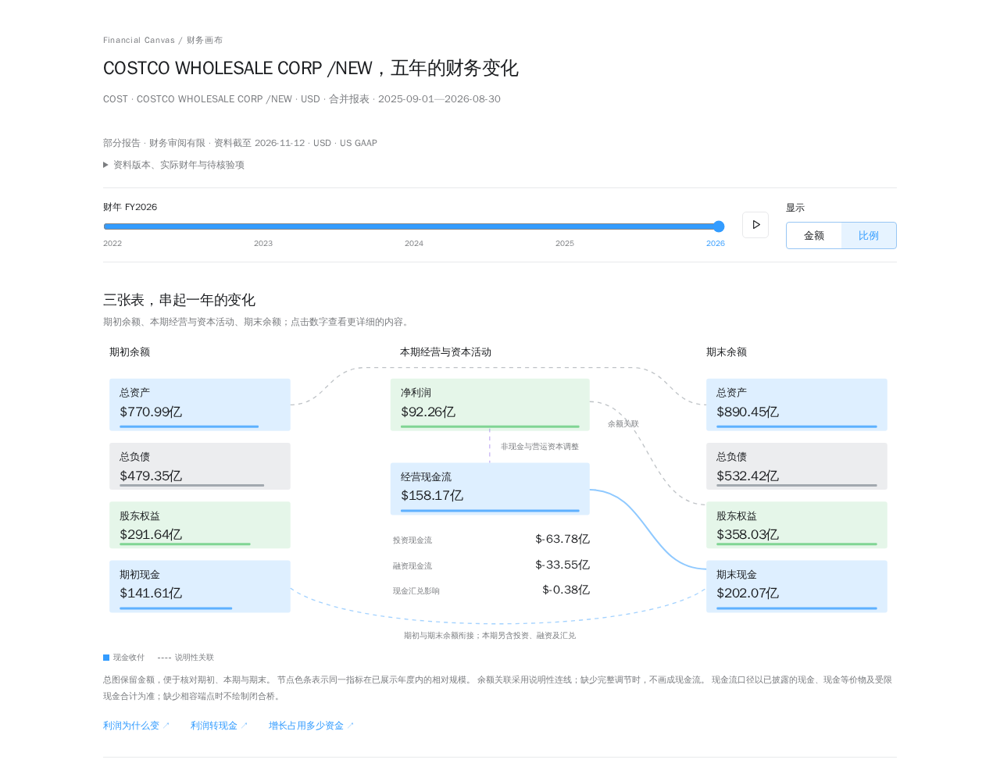
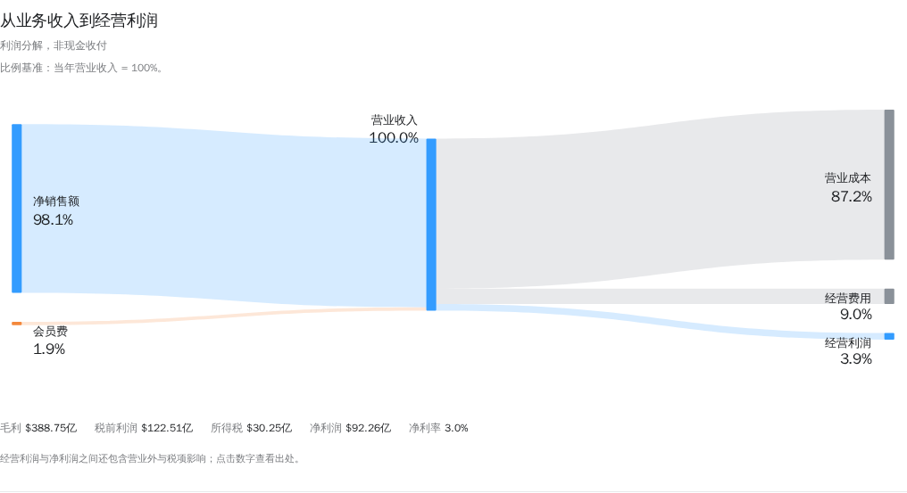

# Financial Canvas · 财务画布

[中文](README.md) · [English](README.en.md)

输入美股股票代码，结合 SEC 数据及对官方财报的补充研究，生成**一家公司一个独立 HTML** 的中文交互财务报告。

这是 MIT 许可的实验版。程序完成取数、缓存、财年识别、事实校验、十进制计算和打包；仓库内的 Skill 指导当前 AI 环境研究官方原文。无需 MCP，也无需为生成器另外配置模型 API。

## 看看报告

直接体验 [PDD 在线报告](https://value.wonderjz.workers.dev/reports/financial-visualizer?symbol=PDD)，或下载已生成的单公司 HTML：

| 离线报告 | 完整财年 | 资料截止 |
| --- | --- | --- |
| [Costco · COST](examples/reports/COST.html) | FY2022–FY2026 | 2026-11-12 |
| [Apple · AAPL](examples/reports/AAPL.html) | FY2022–FY2026 | 2026-11-12 |
| [Adobe · ADBE](examples/reports/ADBE.html) | FY2021–FY2025 | 2026-11-12 |

下载 HTML 或克隆仓库后，用浏览器打开即可交互；GitHub 文件页显示的是源码。三个示例均为 USD、只含一家公司的数据，内嵌样式与脚本，可完全离线阅读。它们保留来源和资料缺口，不代表完整财务审计。PDD 链接是 WonderValue 既有历史页面，使用不同的数据补充路径；本仓库未复制该页面或其旧数据。详见 [示例及来源说明](examples/README.md)。

下面是 COST 报告的实际截图，可以切换年度、金额/比例，并点击指标查看出处：



<details>
<summary>查看营业收入到经营利润的分解</summary>



</details>

## 开始使用

生成需要 Python 3.10+，核心仅使用标准库。首次取数需要网络；阅读生成的 HTML 只需浏览器，不需要服务、Python 或联网。

```bash
git clone https://github.com/wonderjz99/financial-canvas.git
cd financial-canvas
```

在可读取本地文件和运行 Python 的 AI 环境中打开项目，然后请求：

> 请读取 `skills/financial-statement-visuals/SKILL.md`，用 Financial Canvas 为 COST 生成最近五个已披露完整财年的财务报告。根据研究清单补充官方证据，保留缺口和来源，交付独立 HTML。

Skill 的执行方式见 [使用指南](docs/skill-usage.md)。它不会另外启动模型服务，单独复制 Skill 也不会安装本项目。

## 命令流程

先准备一个新的工作目录：

```bash
python3 scripts/report.py prepare --symbol COST --workspace .local/v2/workspaces/COST-demo
```

`prepare` 返回标准化事实、官方原件、检查和研究清单。可用 `--user-agent "项目名 联系邮箱"` 或 `SEC_USER_AGENT` 提供 SEC 访问标识。目录已经存在时换一个名字。

阅读 `research-tasks.json`、`normalized.json` 和 `checks.json`，根据官方 HTML 或其他有依据的原文整理 `supplements.json`。不要手改原始来源或 normalized.json，也不要为了闭合关系编造金额。

随后离线构建：

```bash
python3 scripts/report.py build --workspace .local/v2/workspaces/COST-demo
```

默认输出 `reports/COST.html`。已有文件须另选 `--output` 或明确 `--overwrite`。可以保留空补充资料生成已有事实支持的部分报告；这不表示已完成完整财务研究。

`prepare --refresh` 获取新版本；默认优先复用有效缓存。刷新失败有旧缓存时注明旧版本，`prepare --offline` 则只使用已有有效缓存。`build` 不联网、不调用 AI，也不自动补数。完整资料契约见 [工作流](docs/report-v2.md)。

## 范围

- US GAAP 美股非金融公司，最多最近五个已披露完整财年，按真实日期及报告币种展示，支持 52/53 周。
- 保留年份、播放、金额/比例、来源、三表和资料支持的深入分析。主营、完整 CFO 调节及跨年可比性需要官方证据。
- 金融/地产 SIC 6000–6999、IFRS、季度、估值、交易暂不支持。身份、币种或年度不能确认时停止。
- 未知不补零，调节不完整不生成假闭合桥。结构与勾稽检查不等于独立财务审计。

仓库附有 COST、AAPL、ADBE 的固定日期示例及逐项来源；不附原始申报、研究工作目录或缓存。自动测试使用合成数据，不能当作真实公司覆盖证明。

## 验证

公开版的默认验证只依赖代码和合成资料：

```bash
python3 -B scripts/verify.py
```

它不会读取 V1 快照或访问金融服务。开发浏览器检查需要 Node.js 22+：

```bash
npm ci --ignore-scripts
npx playwright install chromium
python3 -B scripts/verify.py --browser
```

CI 检查 Linux Python 3.10/3.12、Windows Python 3.12 和 Chromium 三视口。公开内容检查覆盖当前 Git 索引与已获取的历史，拒绝旧数据和未审阅报告，并核对三个示例的哈希、单公司身份和官方来源。详见 [开发指南](docs/development.md)。

## 目录与许可

- `scripts/report.py`：命令入口；`financial_visualizer/`：校验、固定计算和导出。
- `skills/`：AI 研究说明；`web/`：离线组件；`tests/`：合成输入与交互测试。
- `examples/`：三个已审阅报告及版本清单；`docs/images/`：实际页面截图。
- `.local/v2/`、`reports/`：本地资料和生成结果，Git 忽略，不随克隆提供。

自有代码、文档和合成测试采用 [MIT](LICENSE)。第三方原始资料、开发依赖、外部服务及其商标不由项目代码许可证授予权利，见 [第三方说明](THIRD_PARTY_NOTICES.md) 和 [资料来源](docs/data-sources.md)。

这是独立的源码发行，未沿用研发仓库的 Git 历史，也不包含旧供应商快照、V1 HTML、原型或内部交接记录。内部协议和目录中的 `v2` 保留兼容性，不属于产品名称。导出与验证边界见 [发行说明](docs/release.md)。
